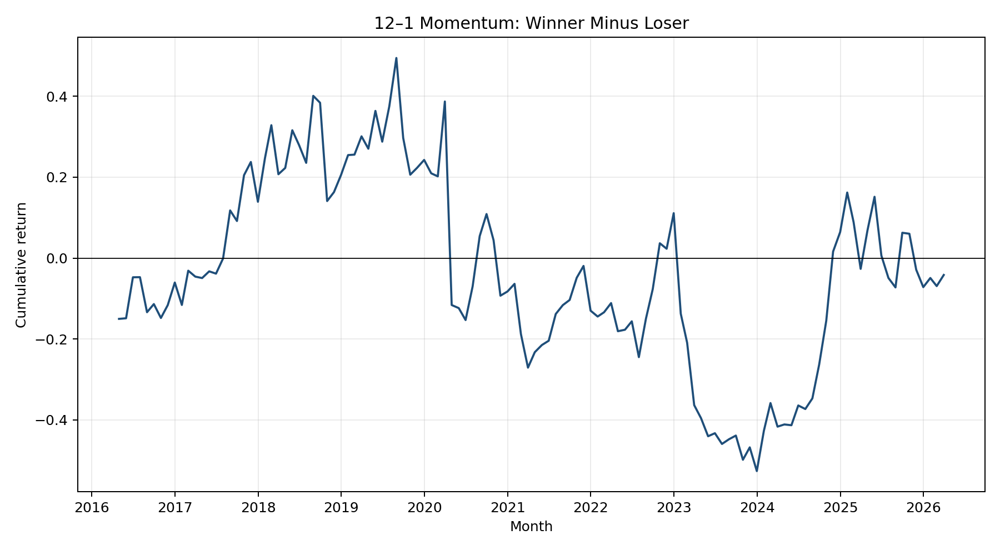
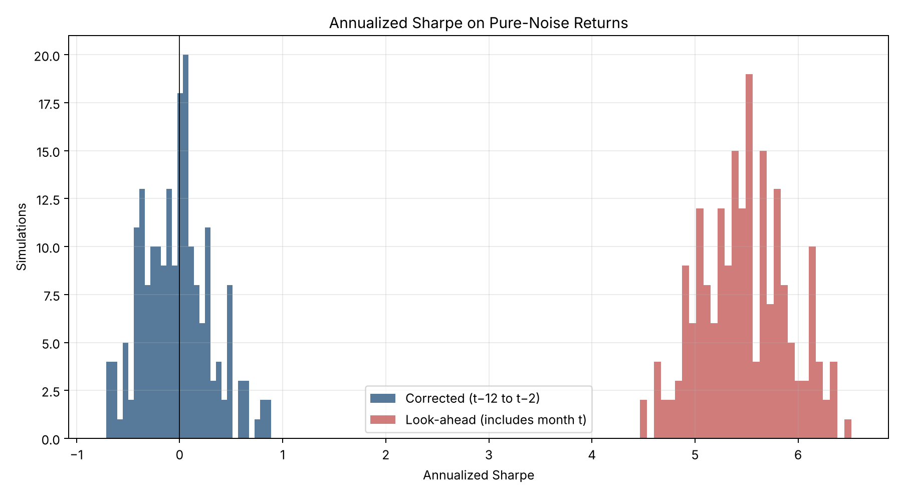

# Cross-Sectional Momentum in U.S. Equities

A clean, reproducible Python backtest of an equal-weighted **12–1 cross-sectional momentum** strategy. This is the corrected version of an earlier analysis whose Sharpe ratio was inflated by look-ahead bias.

## What was fixed

For a portfolio held in month **t**, the signal uses only returns from **t−12 through t−2**:

```text
signal(t) = product(1 + return[t-12:t-2]) - 1
portfolio return(t) = return[t]
```

Month `t−1` is skipped, and month `t` is never used to rank stocks for month `t`. An automated test changes the holding-month return and verifies that the signal and portfolio membership do not change.

## Results

Default run (`python run_backtest.py`): first 50 current S&P 500 constituents, April 2016 to March 2026, 120 monthly long–short returns.

| Statistic | Value |
| --- | ---: |
| Mean monthly return | 0.45% |
| Annualized return (geometric) | 0.54% |
| Annualized volatility | 30.4% |
| Annualized Sharpe (zero risk-free rate) | 0.18 |
| t-statistic (p-value) | 0.56 (0.58) |
| Maximum drawdown | −68.3% |
| Market beta (p-value) | −0.25 (0.18) |



The two largest losses are classic momentum crashes: in spring 2020 the losers of the COVID sell-off rebounded sharply while past winners lagged, and in early 2023 the beaten-down 2022 losers rallied as the previous year's winners reversed.

Once the look-ahead bias is removed, the estimated premium in this small universe is **not statistically distinguishable from zero**. That is a statement about power, not about momentum: with 120 monthly observations the standard error of an annualized Sharpe ratio is roughly 0.3, so this sample can neither confirm nor rule out a premium of the size reported in the literature. With only about five stocks per leg, volatility is also high and the long–short book suffers a deep drawdown. The inflated Sharpe of the original analysis came from the timing error, not from momentum.

## Monte Carlo placebo test

To show how large the original bias was, `run_placebo.py` simulates 200 samples of pure-noise returns (50 stocks, 134 months, IID normal with 8% monthly volatility), so the true momentum premium is zero. Each sample is run through both the original look-ahead signal (12 months ending at `t`) and the corrected 12–1 signal:

| Pipeline | Mean annualized Sharpe | 5th–95th percentile |
| --- | ---: | ---: |
| Original (signal includes month `t`) | 5.48 | 4.83 to 6.18 |
| Corrected (months `t−12` to `t−2`) | −0.03 | −0.55 to 0.58 |

The original pipeline reports a Sharpe above 5 on data that contain no signal at all; the corrected pipeline is centred on zero, as it should be.

```bash
python run_placebo.py --sims 200 --seed 0
```



Results are written to `results/placebo_summary.json`, `results/placebo_simulations.csv`, and `results/placebo_sharpe.png`; a committed copy of the summary and chart for the default run is in `docs/`.

## Method

Each month, stocks are ranked by their 12–1 signal. The strategy buys the top decile and shorts the bottom decile with equal weights. The monthly return is the mean winner return minus the mean loser return.

`run_backtest.py` also:

- averages simple returns within portfolios;
- compounds the long–short return geometrically;
- labels regimes ex ante using market returns through `t−1`;
- reports annualized Sharpe, maximum drawdown, a t-test, and market beta;
- saves the exact universe, monthly returns, statistics, and chart.

Returns are indexed on a complete calendar-month grid before the signal is computed. If any month inside a stock's 11-month signal window is missing, that stock has no signal for the month rather than a silently shifted window.

The default sample uses the first 50 symbols from the current S&P 500 table to remain comparable with the original coursework. Use all current constituents with `--max-tickers 0`, or provide a researched point-in-time universe with `--tickers-file`.

## Important limitations

- **Survivorship bias:** the default universe uses today's S&P 500 membership, not historical membership.
- **Small portfolios:** with 50 stocks, each decile contains only about five names.
- **Data source:** Yahoo Finance data accessed through `yfinance` is not a research-grade point-in-time database.
- **Trading frictions:** costs, short borrow, slippage, taxes, and capacity are omitted.
- **Inference:** the ordinary t-statistic does not correct for every form of dependence or data snooping.

## Run it

Python 3.11+ is recommended.

```bash
python -m venv .venv
source .venv/bin/activate
pip install -r requirements.txt
python run_backtest.py --start 2016-04-01 --end 2026-04-01 --max-tickers 50
```

The end date is exclusive. Prices are cached under `data/`; generated tables and figures go to `results/`.

For a custom universe, create a text file containing one ticker per line or comma-separated tickers:

```bash
python run_backtest.py --tickers-file my_universe.txt
```

Run the checks locally with `pytest`.

## Repository layout

```text
momentum/
  backtest.py     signal, decile portfolios, performance and regime statistics
  data.py         ticker list, Yahoo Finance download, monthly returns
  placebo.py      Monte Carlo placebo (look-ahead vs corrected signal)
tests/            timing, alignment and statistics checks
docs/             figures and summary committed for the README
run_backtest.py   main study
run_placebo.py    placebo experiment
requirements.txt
README.md
```
